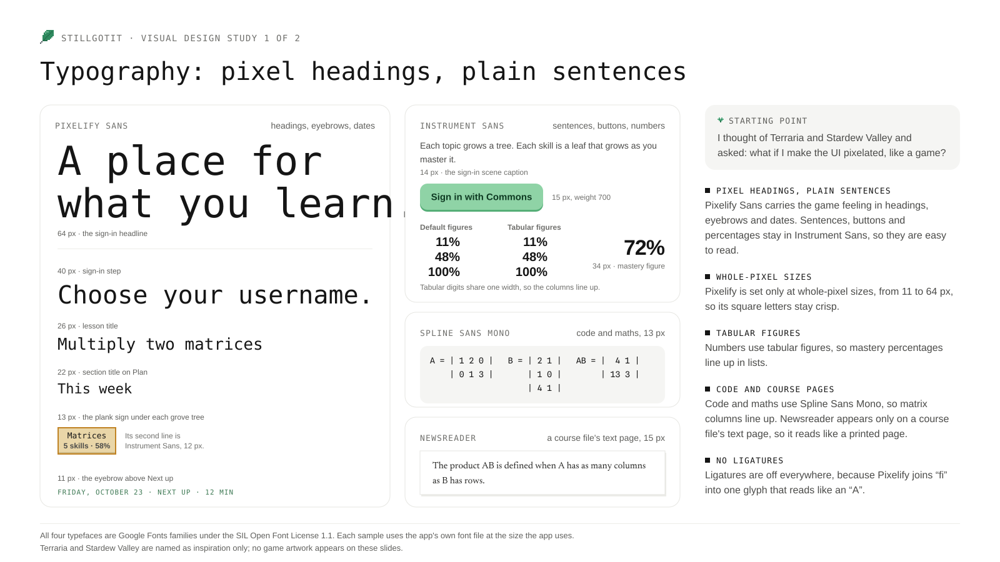
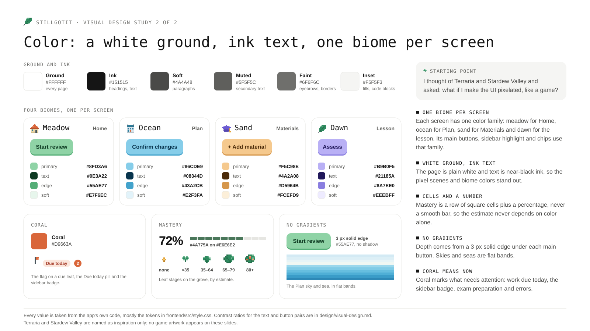

# Visual design study

The app's look is called Pixel Nature. It started with Terraria and Stardew Valley: I thought of their pixel-art interfaces and asked, "what if I make the UI pixelated like a game?" I worked the idea out with a design tool, and the result is recorded in the [design handoff](revamp/README.md), which sets the palette, the type, the pixel-art rules, and the layout of each screen.

The study has two slides, one for typography and one for color. Each slide is a collage of the app's own type or colors, set in the app's own font files, with my notes in the margin. The two games are named as inspiration only; no game artwork appears on the slides.

## Where each choice is used

The main colors and the font names are tokens at the top of [frontend/src/style.css](../frontend/src/style.css). [frontend/src/fonts.css](../frontend/src/fonts.css) declares the four typefaces, and the server sends their files from `/fonts`.

### Typography

- **Pixelify Sans carries the headings.** It is used for page and section titles, eyebrows (the small uppercase labels above a heading), the brand, and big dates. It is set only at whole-pixel sizes, so its square letters stay crisp:
  - 64 px for the sign-in headline, "A place for what you learn.", and 40 px for the next sign-in steps, such as "Choose your username."
  - 34 px for the lesson's welcome heading, 28 px for a file's title in Materials, and 26 px for the lesson title and the Settings title.
  - 24 px for the title on the Home scene card and the planner's trade-off headline.
  - 22 px for section titles, such as "Materials", "This week" on Plan, "Course forest", and the Manage skills heading.
  - 20 px for the brand in the sidebar and for each day's date on the Plan sea calendar.
  - 13 px for the plank signs under the grove's trees and over the exam flag on Home's scene card, and 11 px for eyebrows, such as "FRIDAY, OCTOBER 23 · NEXT UP · 12 MIN" on the scene card.
- **Instrument Sans carries everything a learner reads at length or presses.** Body text is 15 px, buttons are 14 or 15 px at weight 700, and the sidebar's navigation rows are 15 px. Big percentages are 30 to 34 px at weight 700 with −1 px letter spacing: the selected skill's estimate on Home, the course average in the Forest view, and "Your mastery" in the lesson's rail.
- **Numbers use tabular figures.** `font-variant-numeric: tabular-nums` is set on the whole page, so every digit has the same width. Percentages line up in the Tasks list, on the grove's plank signs ("5 skills · 58%"), in the Forest view's topic list, and in the evidence timeline.
- **Spline Sans Mono is for code and maths.** The tutor's code and maths blocks in the lesson are 13 px. In the Materials viewer, code files, notebook cells, spreadsheet sheets, and code in Markdown are 13 px, and the "Readable text" tab is 12 px.
- **Newsreader is used on one page only.** When the Materials viewer cannot draw a PDF page, it shows that page's readable text on a white page set in Newsreader at 15 px, so it still reads like a printed page.
- **Ligatures are off everywhere.** Pixelify Sans joins "fi" into one glyph that reads like an "A", so `style.css` turns ligatures off for every element.

### Color

- **A white ground and ink text.** The page, cards, and dialogs are white (`#FFFFFF`). Headings and main text are ink (`#151515`). Longer paragraphs, such as the sign-in introduction and rendered Markdown, are soft (`#4A4A48`). Hints and captions are muted (`#5F5F5C`), and eyebrows and form-field outlines are faint (`#6F6F6C`). Code blocks, the sign-in steps, and other fills use inset (`#F5F5F3`).
- **One biome per screen.** Each screen has one color family. Its primary buttons use the family's main color with its dark text and a 3 px edge below in the edge color. Its secondary buttons and chips use the soft color, and the selected row in the sidebar is a capsule in the family's light tint.

  | Biome | Screen | Primary | Text | Edge | Soft | Used for |
  | --- | --- | --- | --- | --- | --- | --- |
  | Meadow | Home, the Forest view, sign-in, Settings | `#8FD3A6` | `#0E3A22` | `#55AE77` | `#E7F6EC` | Start review on the scene card, Open lesson, Back to desk, Sign in with Commons, the chosen Home view tile in Settings |
  | Ocean | Plan | `#86CDE9` | `#08344D` | `#43A2CB` | `#E2F3FA` | Start review and Finish review, Confirm changes on a trade-off, Save exam, Update plan |
  | Sand | Materials | `#F5C98E` | `#4A2A08` | `#D5964B` | `#FCEFD9` | + Add material, Confirm · add a leaf, Find skills, Import graded work, the buttons in Manage skills |
  | Dawn | The lesson | `#B9B0F5` | `#21185A` | `#8A7EE0` | `#EEEBFF` | Check my understanding, Assess, Save adjustment, the learner's own messages |

- **Coral marks what needs attention now.** Coral (`#C35124`) fills the sidebar's badge on Materials, which counts the suggested skills waiting for review. The pixel flag planted beside a leaf that is due today keeps the lighter coral `#D9663A`, because it is art, not text. Coral's wash and text (`#FBE6DC` and `#A8412F`) form the Due today pill in the Tasks list and every error message, and the wash marks exam preparation in the Plan calendar.
- **Three more colors mark states.** Green (`#2A7B55`) marks success: saved notices, the Strong pill, and finished items. A sun-yellow wash marks the New pill and practice items in the plan, and a sky wash marks the Review pill and lessons in the plan.
- **Mastery is cells and a number, never a smooth bar.** `MasteryCells.vue` draws square cells with 2 px gaps, `#4A775A` when filled and `#E6E6E2` when empty, always beside a number. Home's skill card and the lesson's rail use 10 cells, each row of the Tasks list uses 10 short cells, and the Forest view uses 20 for the whole course. The Plan calendar uses 6 cells in its own blue (`#1E6F96` on `#CFE7F2`) for the minutes planned each day, and the sidebar's Today card uses 15 sun-yellow cells for the minutes studied today.

### Pixel art

- **Icons and sprites are letter grids.** [frontend/src/pixel-art.ts](../frontend/src/pixel-art.ts) holds 12×12 icons and 7×7 sprites, each letter naming one palette color. `PixelIcon.vue` draws them as SVG rectangles with crisp edges. The icons are the sidebar's navigation icons (home, calendar, school for Materials, and tree for the Forest view), the leaf brand mark, the sun on the Today card, the ⓘ button, the lighthouse on an exam day, and the file icons in Materials, whose bottom band is coral for a PDF, yellow for slides, green for an image, and blue for Markdown.
- **A skill's leaf shows its growth stage.** The sprites are a bud (no estimate yet), a sprout (under 35%), a leaf (35% to 64%), a full leaf (65% to 79%), and a bloom (80% and up). They appear on the grove, in the Tasks list, in the Forest view, in the grove's legend, and in the sample grove on the sign-in page.
- **Scenes are drawn in whole cells.** Each scene is a canvas of 4 px cells (5 px in the Forest view, and 2 px in the small grove on the sign-in page), scaled by the screen's pixel ratio with smoothing off:
  - Home's scene card has sky bands, hills, and a sand path with one post per day leading to the exam's flag. The sun's position follows today's study minutes.
  - The grove on Home has one seeded tree per topic, with a plank sign under each tree that names the topic and gives its skill count and average.
  - The Forest view has mountains, pines, a winding path, and one large tree per topic with a signpost, plus a flower at a tree's foot for each mastered skill.
  - The Plan screen's sea calendar is one picture of the week. Each day is a column of the water, with its date on a sand plank, its boat, buoy, or lighthouse at the horizon, and its activities floating on the water. A whale, taken from the handoff, swims from today toward the exam's lighthouse.
  - The sign-in page shows a sample grove with topic signs and a legend of the leaf stages.
- **There are no gradients.** Skies and seas are solid bands of color. Depth comes from the 3 px solid edge under primary buttons (`box-shadow: 0 3px 0` with the edge color), which shrinks to 1 px when the button is pressed.

### Charts and summaries

The charts add no colors; each one comes from the palette above or from `pixel-art.ts`.

- **The estimate over time.** The Evidence card in the lesson's rail draws a skill's estimate from its starting point to now, above "How the estimate got here" ([frontend/src/EstimateChart.vue](../frontend/src/EstimateChart.vue)). Time runs left to right, labeled with the first date and the last ("Today"). The estimate runs from 0 at the bottom to 100 at the top, with 1 px lines in the ring grey (`#E6E6E2`) at 35%, 65% and 80%, where the leaf stages change. The estimate is a 2 px stepped line in the filled mastery cell's green (`#4A775A`, 5.15:1 on white): it jumps at each assessed attempt and adjustment, and time without practice lowers it in stairs of 2 px steps. Every coordinate is a whole pixel, so the edges stay crisp. The value now is printed in ink at the end of the line.
- **One mark for each kind of change.** Each mark is a 10×10 letter grid in `pixel-art.ts`, used on the chart and as the row icon in the timeline: a hollow slate square (`#5C6B73`, 5.52:1) for the starting point, a filled violet square (`#5546B0`, 7.27:1) for an assessed attempt, a hollow violet diamond for an adjustment, a green falling stair for time without practice, and a filled slate square for an attempt that did not count. Shape tells the kinds apart, not color alone. On the chart each mark sits in a 2 px white ring, so it stays clear of the line, and a legend under the chart names only the marks it shows.
- **Reading the chart without pointing.** Each mark on the chart is a button. Hovering, focusing or tapping it shows a dark tooltip (`#1C1C1D`, like the ⓘ bubbles) with the values, what happened and the date, and Escape hides it. The button's label says the same, and a visually hidden table lists every row with its date, event, and values before and after. The timeline below says it all again in sentences. When no attempt has counted yet, a line under the chart says so.
- **The timeline as dated rows.** "How the estimate got here" has one row per change: the date over its weekday, the kind's mark on a lavender rail (`#E3DEF7`), a plain sentence such as "Independent success on fresh work in Practice 3 raised it from 54% to 95%.", how long after the previous change it came and how much time lowered it, and, in a right-hand column, the new value over "from" the old one. "Attempts that did not count" uses the same columns, with the reason in place of the timing.
- **The course summary in the Forest view.** Beside the forest, and under it on phones, "Course progress" shows the course average as a 34 px number over a row of 20 mastery cells, then four tiles with the number of skills mastered, growing, new and due today, each with its sprite ([frontend/src/CourseProgress.vue](../frontend/src/CourseProgress.vue)). These counts used to be chips in the header. Each topic row below shows the topic's title, its average as 14 cells and a number, and its skill count; choosing a row opens that topic, as choosing its signpost does.
- **Motion.** When the evidence opens, the line draws itself from the starting point to today, and each mark and the value now appear as the line reaches them (see "Motion" below). Nothing in the chart moves after that.

### The lesson's conversation

- **Tabs name each conversation.** Above the thread, each tab shows the conversation's kind and number ("Lesson 2", "Practice 1"), the day it started, and how many turns it has, such as "Oct 25 · 4 turns", with ✓ once it is assessed.
- **The opening is a card.** The tutor's lesson, or the practice task, sits in a white card with a ring, below the learner's request. A rule labelled "Conversation", in the eyebrow style, separates it from the dialogue that follows.
- **The learner's messages are bubbles; the tutor's replies are not.** The learner's messages are compact dawn bubbles (`#EEEBFF`) on the right, at most 70% of the thread's width (85% on phones). The tutor's replies run the full width without a bubble: a first line with the leaf in a small dawn tile and "StillGotIt", then the reply at 15 px with a 1.8 line height, and code and maths in mono blocks.
- **Each reply ends with its sources, one meta line and small actions.** The sources the reply cites follow it as one row of "From <source> ↗" chips, the same chips as under the lesson; choosing one opens the passage below the row. The meta line is 11 px in faint text: how long the answer took (timed by the page when it saw the answer arrive, otherwise from the saved times of a lesson reply that was not retried), how many sources it cites, and the model and thinking level when the page saw the answer arrive, such as "Answered in 7 s · 2 sources · Gemini 3.8 Flash · Medium thinking". Copy and Listen sit at the right of that line. They appear when the pointer is over the reply or focus is inside it, and they always show under the latest reply and on touch screens. When a lesson question has no reply, "Retry tutor reply" sits in the tutor's place.
- **A message's time is in its tooltip.** Hovering a message shows when it was saved, such as "Oct 25, 3:04 PM". Screen readers hear the same time after the speaker's name.
- **The thread stays where the learner is reading.** New messages scroll the thread to the latest one. When the learner has scrolled more than one screen up, a white "Jump to latest ↓" pill appears over the bottom of the thread instead.
- **The message box grows with its text.** It starts at two lines and grows to six; longer text scrolls inside it. Enter sends, and Shift+Enter starts a new line.
- **An open lesson can be finished.** "Finish lesson" ends the message box's tools, in the same outlined pill that holds "Ask for a hint" in practice, and acts at once, as the app's other lasting actions do; a message still in the box must be sent or cleared first. A finished lesson keeps its tab and thread but offers no "Retry tutor reply", and in place of the message box it shows "This lesson is finished. Start a new conversation to keep going." with "Keep learning", as a submitted attempt shows "This attempt is saved."
- **Assessment cards show the change in mastery.** Beside the result, "Mastery" heads the estimate before and after the attempt, such as "50% → 95%", with the change in points below. An attempt that did not count says "Did not change the estimate" and gives the reason.

### Motion

Motion shows what just changed, and it keeps the three scenes quietly alive. It runs on four Bézier curves and four durations, kept as tokens at the top of [frontend/src/style.css](../frontend/src/style.css), and every keyframe the app uses is written there once.

- **Four curves, named for what they move.** `--ease-enter` (`cubic-bezier(.22, 1, .36, 1)`) is for things that appear or fade away: it starts fast and lands softly. `--ease-move` (`cubic-bezier(.65, 0, .35, 1)`) is for things that travel from one place to another, and it leaves as gently as it arrives. `--ease-grow` (`cubic-bezier(.2, .9, .3, 1.2)`) is for things that grow into place, with a small overshoot that settles. `--ease-loop` (`cubic-bezier(.37, 0, .63, 1)`) is a soft swell, like a sine wave, for the scenes' loops and the waiting signs.
- **Four durations.** `--dur-quick` (120 ms) is for presses, color changes and controls that fade in. `--dur-enter` (240 ms) is for cards, messages, notices, bubbles and dialogs coming in. `--dur-move` (320 ms) is for the lesson's rail, the sidebar's capsule and the lesson's tab mark. `--dur-draw` (520 ms) is for the estimate line drawing itself. Nothing a person starts takes longer than 520 ms. The waiting signs keep a 1.2 s beat (`--loop-beat`).
- **Things that come in.** Cards, messages, assessment cards, ⓘ bubbles and the "Jump to latest ↓" pill rise 8 px into place over 240 ms on the entrance curve. File cards and attachment chips grow from 92% on the grow curve, and notices and errors fade in. Dialogs, and the Forest view when it opens, scale up from 96% as they fade in, and a dialog's backdrop fades in with it. Copy and Listen fade in under a reply over 120 ms, and buttons change color and press over 120 ms. A cited page or passage in the Materials viewer holds its highlight, then lets it go over 520 ms.
- **Things that move.** The sidebar's capsule slides from the current row to the next one over 320 ms on the move curve, taking on the new view's biome color as it goes; on phones it slides along the row of views. The line under the lesson's chosen tab slides to the next tab the same way. On narrow screens the evidence rail slides in 24 px from the right as it fades in, and it slides back out when it closes, while the shade behind it fades.
- **Waiting signs.** While the tutor answers, three dots rise and brighten one after another on the 1.2 s beat. The star beside a graded import's progress and the recording square pulse softly on the loop curve, where the recording square used to blink in two steps.
- **The scenes move on eased loops.** Each scene draws what stays still once, and lays the sprites that move over it. Each sprite eases on the loop curve, most of them one way and back, each with its own length and starting point, so nothing moves in step. On Home, the clouds drift 10 to 21 cells and back, taking 18 to 32 seconds each way, which is a few pixels a second at most; the exam flag's cloth ripples, one column a little after the next; and the leaf on its mound bobs 3 px. On Plan, the clouds drift the same way; the wave glints sway 4 px, alternate rows in opposite directions; the buoys and the boat bob 3 px and rock 1 px; the lighthouse lamp breathes from deep to pale yellow over 1.5 s, and its beam fades in as it brightens; and the whale crosses from today toward the lighthouse at about 4 px a second, fading in at the start and out at the end, diving 8 px every 7 seconds, a little fainter at the bottom of each dive, and spouting as it surfaces. In the Forest view, the clouds drift the same way, in front of the sky and behind the mountains.
- **Crisp pixels.** This replaces P3's 450 ms tick, which moved the scenes in steps, because the owner chose eased curves over stepped motion. The pixel edges stay crisp because the drawings themselves never change shape; only their position eases, and each offset is rounded to a whole device pixel.
- **The chart draws itself.** When the evidence opens, the estimate line draws from the starting point to today over 520 ms on the entrance curve. Each mark, and then the value now, fades in as the line reaches it, while the rows of "How the estimate got here" rise in one after another, 40 ms apart, and any rows after the seventh rise with the seventh. Nothing in the chart moves after that.
- **Reduced motion.** When the device asks for reduced motion, every animation and transition is turned off. Cards and panels appear in their final place, the chart is drawn whole, and scrolling jumps instead of gliding. The scenes are drawn once with every sprite where its loop starts: the whale near today with its spout showing, and the lighthouse lamp lit with its beam.

### Contrast

Text should reach 4.5:1 against its background, and outlines and cells that carry meaning should reach 3:1. These are the ratios for the main text and button pairs:

| Pair | Where | Ratio |
| --- | --- | --- |
| Ink `#151515` on white | Headings and main text | 18.26:1 |
| Soft `#4A4A48` on white | Paragraphs | 8.88:1 |
| Muted `#5F5F5C` on white | Hints and captions | 6.41:1 |
| Muted `#5F5F5C` on inset `#F5F5F3` | Text inside the sign-in steps | 5.87:1 |
| Faint `#6F6F6C` on white | Eyebrows | 5.04:1 |
| `#3F7A55` on white | The eyebrow on Home's scene card | 5.09:1 |
| Ink `#151515` on a plank `#E9D6A8` | Topic names on the grove | 12.74:1 |
| Soft `#4A4A48` on a plank `#E9D6A8` | "5 skills · 58%" on the grove | 6.20:1 |
| White on `#1C1C1D` | The ⓘ bubbles and disabled-button reasons | 17.03:1 |
| Meadow text `#0E3A22` on `#8FD3A6` | Meadow primary buttons | 7.31:1 |
| Ocean text `#08344D` on `#86CDE9` | Ocean primary buttons | 7.41:1 |
| Sand text `#4A2A08` on `#F5C98E` | Sand primary buttons | 8.38:1 |
| Dawn text `#21185A` on `#B9B0F5` | Dawn primary buttons | 7.89:1 |
| `#1C5A37` on `#E7F6EC` | Meadow secondary buttons | 7.32:1 |
| `#0D4F70` on `#E2F3FA` | Ocean secondary buttons | 7.78:1 |
| `#7A4A12` on `#FCEFD9` | Sand secondary buttons | 6.57:1 |
| `#3B2F8F` on `#EEEBFF` | Dawn secondary buttons | 9.03:1 |
| Ink on the sidebar capsules `#C6EAD1`, `#C3E6F4`, `#FADFB5` | The selected row in the sidebar | 13.99:1, 13.87:1, 14.16:1 |
| White on `#1E6F96` | The exam day's plank on Plan | 5.57:1 |
| `#A8412F` on `#FBE6DC` | Error messages and the Due today pill | 5.04:1 |
| `#8A5A12` on `#FBF0D6` | The New pill | 5.22:1 |
| `#2A6B85` on `#E3EEF3` | The Review pill | 5.03:1 |
| Green `#2A7B55` on white | Saved notices, such as "Skill confirmed." | 5.17:1 |
| Green `#2A7B55` on `#EEF7F1` | The Strong pill | 4.73:1 |
| Green `#2A7B55` on `#E7F6EC` | The "App default" tag in Settings | 4.63:1 |
| White on coral `#C35124`, and coral on white | The sidebar's Materials badge, on an unselected and a selected row | 4.64:1 |
| `#A46626` on white | "N to review" in the Materials file list | 4.66:1 |
| `#777094` on white | Eyebrows in the estimate's evidence, such as "How the estimate got here" | 4.64:1 |
| `#777094` on white | Eyebrows in the lesson's rail cards: "Your mastery", "Goal", and "To master it" | 4.64:1 |
| Filled cell `#4A775A` against empty `#E6E6E2` | Mastery cells (3:1 needed) | 4.12:1 |
| `#1E6F96` against `#CFE7F2` | Plan load cells (3:1 needed) | 4.34:1 |
| Faint `#6F6F6C` on white | Form-field outlines (3:1 needed) | 5.04:1 |

Every text pair now passes. The last two to change were "N to review" in the Materials file list and the eyebrows in the lesson's rail cards, both small text at 11 and 12 px, which moved to `#A46626` and `#777094`, darker colors of the same hues. The green, the coral, and the evidence eyebrows were darkened within their own hues to pass. The success green and the coral changed everywhere the interface uses them as text, outlines, or fills; the pixel art keeps its own palette.

How the ratios were computed

Each ratio is (L1 + 0.05) / (L2 + 0.05), where L1 is the relative luminance of the lighter color and L2 that of the darker one (WCAG 2.2). For each of R, G, and B, take v = channel / 255, and use v / 12.92 when v ≤ 0.04045, or ((v + 0.055) / 1.055)^2.4 otherwise. Then L = 0.2126 R + 0.7152 G + 0.0722 B.

For example, ink `#151515` has v = 21 / 255 = 0.0824 in each channel, so each channel is ((0.0824 + 0.055) / 1.055)^2.4 = 0.0075, and L = 0.0075. Against white (L = 1), the ratio is 1.05 / 0.0575 = 18.26.

| Color | L | Color | L | Color | L |
| --- | --- | --- | --- | --- | --- |
| `#FFFFFF` | 1.0000 | `#86CDE9` | 0.5461 | `#FBE6DC` | 0.8227 |
| `#151515` | 0.0075 | `#08344D` | 0.0304 | `#A8412F` | 0.1231 |
| `#4A4A48` | 0.0682 | `#F5C98E` | 0.6314 | `#FBF0D6` | 0.8768 |
| `#5F5F5C` | 0.1139 | `#4A2A08` | 0.0313 | `#8A5A12` | 0.1276 |
| `#6F6F6C` | 0.1583 | `#B9B0F5` | 0.4796 | `#E3EEF3` | 0.8395 |
| `#F5F5F3` | 0.9119 | `#21185A` | 0.0171 | `#2A6B85` | 0.1270 |
| `#3F7A55` | 0.1563 | `#E7F6EC` | 0.8896 | `#2A7B55` | 0.1531 |
| `#E9D6A8` | 0.6824 | `#1C5A37` | 0.0784 | `#EEF7F1` | 0.9105 |
| `#1C1C1D` | 0.0117 | `#E2F3FA` | 0.8717 | `#C35124` | 0.1761 |
| `#8FD3A6` | 0.5518 | `#0D4F70` | 0.0685 | `#B5702A` | 0.2158 |
| `#0E3A22` | 0.0323 | `#FCEFD9` | 0.8744 | `#777094` | 0.1765 |
| `#C6EAD1` | 0.7545 | `#7A4A12` | 0.0908 | `#4A775A` | 0.1539 |
| `#C3E6F4` | 0.7473 | `#EEEBFF` | 0.8481 | `#E6E6E2` | 0.7891 |
| `#FADFB5` | 0.7644 | `#3B2F8F` | 0.0495 | `#1E6F96` | 0.1385 |
| `#7A7397` | 0.1863 | | | `#CFE7F2` | 0.7683 |

## Sources

- **The design handoff.** [design/revamp/README.md](revamp/README.md) records the Pixel Nature look, with the clickable prototype `StillGotIt A5 - Pixel Nature.dc.html` and the pixel-art data in `pixel-art.js`. The handoff says its type and pixel palette come from the WhaleLife app's theme files, and the Plan sea's whale is WhaleLife's.
- **The fonts.** All four typefaces are Google Fonts families under the [SIL Open Font License 1.1](https://scripts.sil.org/OFL), which allows them to be bundled with the app and embedded in the slides. The files in `frontend/public/fonts` carry these notices:
  - Pixelify Sans: Copyright 2021 The Pixelify Sans Project Authors (https://github.com/eifetx/Pixelify-Sans).
  - Instrument Sans: Copyright 2022 The Instrument Sans Project Authors (https://github.com/Instrument/instrument-sans).
  - Spline Sans Mono: Copyright 2022 The Spline Sans Mono Project Authors (https://github.com/SorkinType/SplineSansMono).
  - Newsreader: Copyright 2020 The Newsreader Project Authors (http://github.com/productiontype/Newsreader).
- **The slides.** Pixelify Sans and Instrument Sans are embedded in each slide. The Spline Sans Mono and Newsreader samples are drawn as outlines taken from the app's own font files. The sprites, icons, and colors come from the app's code.
- **The starting point.** Terraria (Re-Logic) and Stardew Valley (ConcernedApe) are named as inspiration only. No artwork or screenshot from either game appears on the slides.
