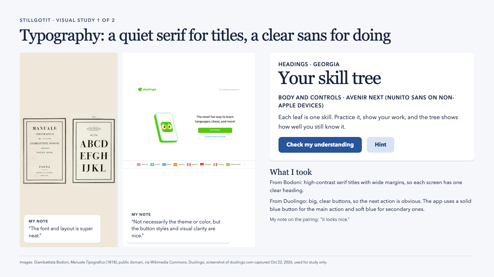
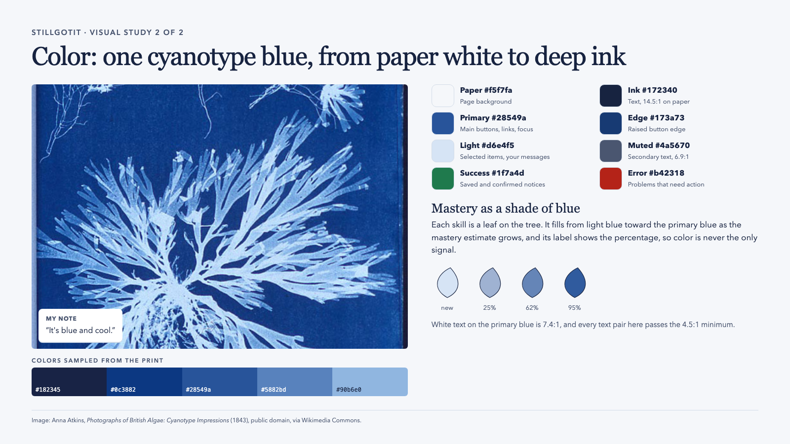

# Visual design study

The study has two slides, one for typography and one for color. Each slide shows the images I kept, my note on each one, and the choices the app takes from them.

## Where each choice is used

### Typography

- **Headings use Georgia.** This follows the Bodoni specimen: a high-contrast serif with plenty of space around it. Each screen has one large serif heading, such as "Your skill tree" or "Course materials", so it is clear where you are.
- **Body text and controls use Avenir Next.** Apple devices include it. Other devices get Nunito Sans, a similar rounded sans-serif that the app serves itself.
- **Buttons are clear about what matters.** This follows Duolingo's clarity without copying its look. The main action is a solid blue button. Secondary actions, such as "Find skills" and "Check my understanding", are soft blue. Suggestions in the chat are outlined pills, and small actions are plain text links.

### Color

- **One blue family, taken from the cyanotype.** The page is a cool off-white (paper). Text is a deep navy (ink). The main buttons, links, and focus rings use the print's middle blue (primary).
- **Light blue marks what is yours or selected.** It is used for your own chat messages, the selected conversation, and count badges.
- **Mastery is a shade of blue, and a number.** The skill tree uses the line drawing from the sign-in page. Each confirmed skill fills one leaf, from light blue toward the primary blue as its mastery estimate grows, and the leaf's label shows the percentage, so the estimate never depends on color alone. Empty leaves are room for new skills. The selected skill also shows its estimate as a ring.
- **Green and red only carry meaning.** Green marks a saved or confirmed result, and red marks a problem that needs action.

### Contrast

Every text color passes the 4.5:1 minimum on the backgrounds it is used on:

| Pair | Ratio |
| --- | --- |
| Ink on paper | 14.5:1 |
| Muted text on paper | 6.9:1 |
| White on primary blue (buttons) | 7.4:1 |
| Primary blue on white | 7.4:1 |
| Success green on paper | 5.0:1 |
| Error red on white | 6.6:1 |
| Form field outline on white | 3.6:1 (outlines need 3:1) |

## Sources

- Anna Atkins, *Photographs of British Algae: Cyanotype Impressions* (1843). Public domain, via [Wikimedia Commons](https://commons.wikimedia.org/wiki/File:Anna_Atkins_algae_cyanotype.jpg).
- Giambattista Bodoni, *Manuale Tipografico* (1818). Public domain, via [Wikimedia Commons](https://commons.wikimedia.org/wiki/File:Manuale-Tipografico1.jpg).
- Duolingo, a screenshot of [duolingo.com](https://www.duolingo.com) taken on October 22, 2026. It is used here only as a study reference.
