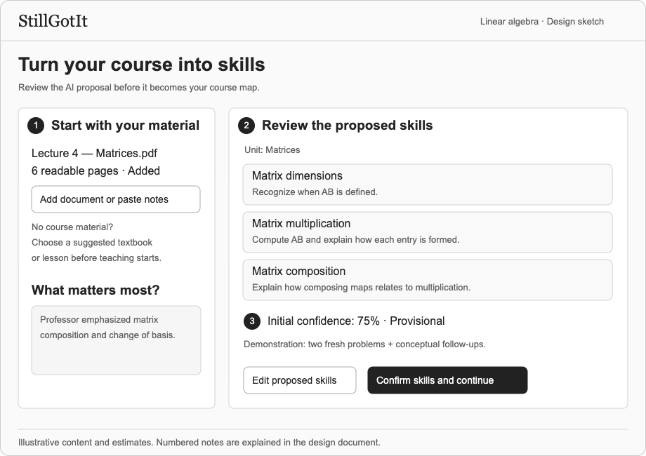
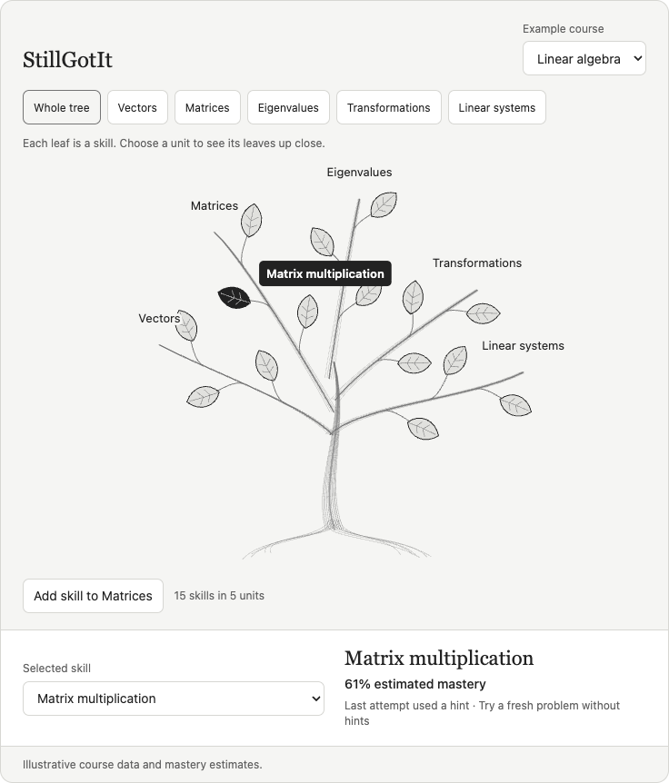
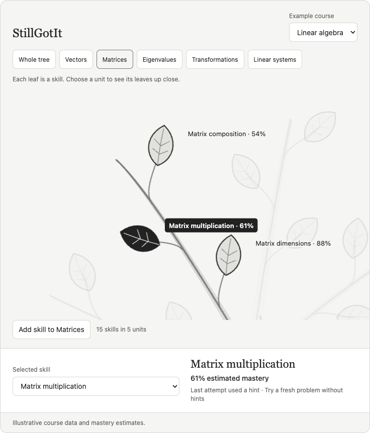
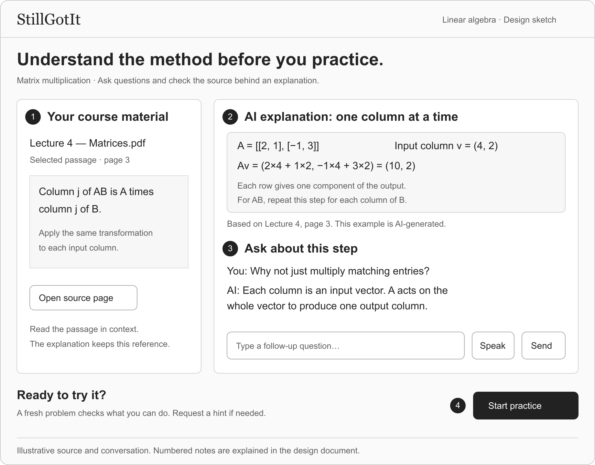
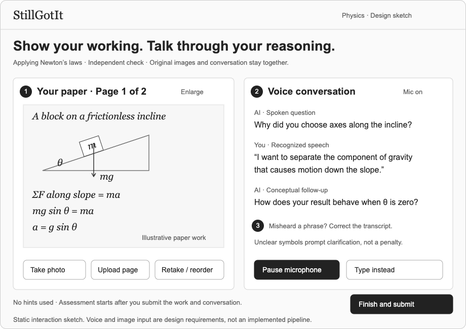
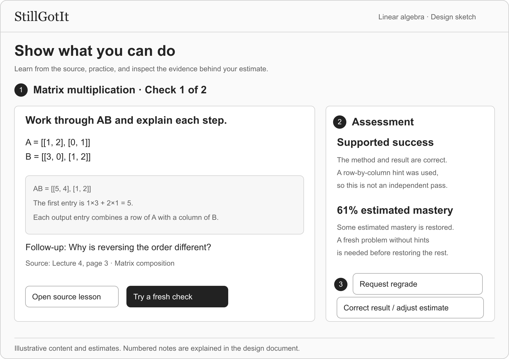
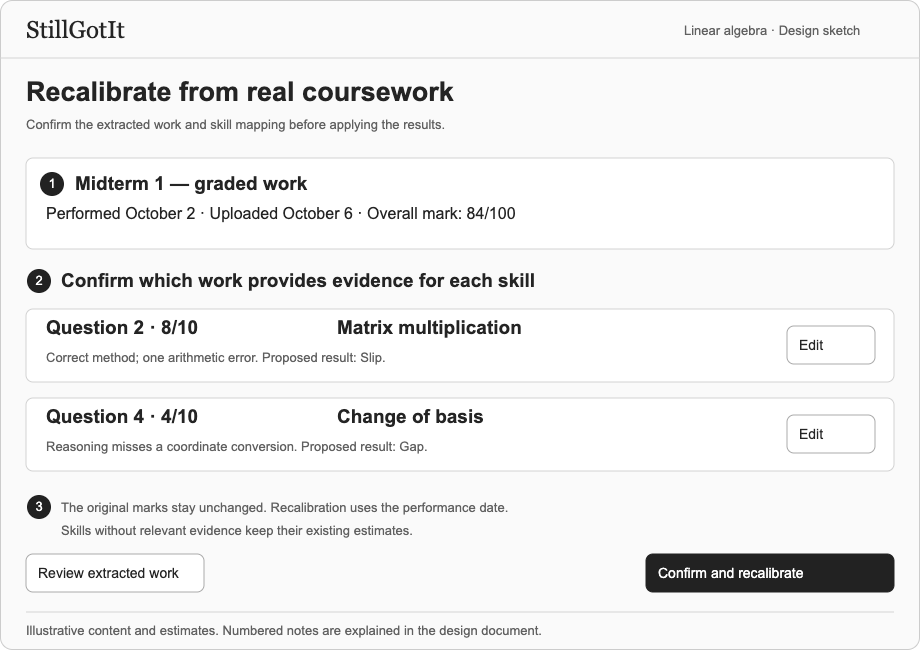
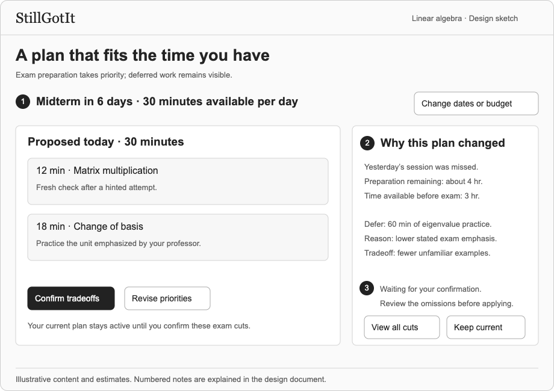

# StillGotIt

> This is the P1 design submission, last revised on October 7, 2026 (commit `b5c3426`). The implemented design has replaced it, and the [design index](../../design/README.md) describes the current design. It was moved here from the repository root on October 25, 2026.

A web app to help students learn course skills and keep using them over time.

## Problem framing and stakeholders

### Domain

Students learn skills for a class, interview, or project. After that task ends, they may stop using those skills. The next class or project can expose gaps they did not know they had.

I want to address the gap between remembering that I learned something and knowing what I can still do. The first version serves college students within one course. It focuses on skills that students can show through worked solutions and explanations. Maintaining skills is the main goal. Students also need help learning or rebuilding a skill when they find a gap.

### Bad situations

**Relearning linear algebra.** I attended lectures, completed problem sets, and could use the material in exams. About a year later, I had forgotten much of the reasoning. When another class required linear algebra, I had to return to my notes. I had no way to notice the loss before I needed the skill again.

**Losing fluency in Java.** In high school, I could write Java without often checking syntax. After I stopped using it, that fluency faded. I still recognize the code and remember the main ideas. But details that once felt automatic now require a search.

The next two examples are hypothetical.

**Finding a gap before an interview.** A student practices dynamic programming, then leaves it unused for a semester. They delay reviewing it because they remember being good at it. Two days before an interview, they cannot derive a recurrence or its base cases. Their study plan relied on an old picture of their ability.

**Reviewing without testing understanding.** A student recognizes food-web diagrams while rereading biology notes. Later, a friend asks how removing one species would affect a different food web. The student can name the relationships but cannot explain the effects. Recognition made the review feel more useful than it was.

### Corroboration

Friends and internship coworkers have described similar experiences. One friend had to recover basic C syntax from old examples after leaving it unused. These accounts help explain the problem. They do not establish its frequency across students.

| Source | Finding and relevance |
| --- | --- |
| [Arthur et al. (1998)](https://doi.org/10.1207/s15327043hup1101_3) | Their analysis covered 189 data points from 53 articles. Skill loss varied with nonuse, task, and assessment method. This supports the problem but argues against one forgetting rate for every skill. |
| [Semb and Ellis (1994)](https://doi.org/10.3102/00346543064002253) | Recognition was generally retained better than recall. The review also found substantial long-term retention. Familiarity can therefore differ from independent recall, without implying that all learning disappears. |
| [Bahrick and Hall (1991)](https://doi.org/10.1037/0096-3445.120.1.20) | Further mathematics education was associated with longer retention of high-school mathematics. Prior learning and later use matter. Rapid loss is not universal. |
| [Roediger and Karpicke (2006)](https://pubmed.ncbi.nlm.nih.gov/16507066/) | Retrieval practice improved delayed retention of prose passages compared with repeated study. This supports asking students to produce answers. |
| [Cepeda et al. (2008)](https://pubmed.ncbi.nlm.nih.gov/19076480/) | Effective spacing depended on the time before the final test. This supports repeated practice but does not establish a fixed schedule for this app. |

These studies support the design direction. They do not validate the app's mastery scores or its effect on complex skills.

### Existing workarounds and comparables

The limitations below describe how each approach fits this problem.

| Approach | What works | What remains difficult |
| --- | --- | --- |
| Notes, textbooks, and old exercises | Use familiar material. Worked exercises can test application. | The learner must choose when to return, select a task, and track earlier errors. Rereading alone does not test independent performance. |
| A friend who tests an explanation | Can notice missing reasoning and ask useful follow-up questions. | Availability varies. Work and feedback can become scattered across conversations. |
| [Anki](https://docs.ankiweb.net/studying.html) | Schedules retrieval practice. Cards can include explanations and problems. | The learner rates the answer. Useful tasks and links to broader skills or graded coursework require setup. |
| [RemNote](https://help.remnote.com/en/articles/6022755-getting-started-with-spaced-repetition) | Connects notes and scheduled practice, including typed answers. | The documented practice flow uses learner ratings. The value of adding worked evidence and coursework still needs testing. |
| [Khan Academy Mastery Challenges](https://support.khanacademy.org/hc/en-us/articles/360037127892-What-are-Mastery-Challenges-in-course-mastery) | Revisits skills through structured exercises. | A student's course material may fall outside the available exercises. |
| [LeetCode study plans](https://leetcode.com/studyplan/) | Provides structured coding and interview practice. | It fits the interview example well. It is less suited to a handwritten derivation or a biology explanation. |

The opportunity is to connect a course skill, worked evidence, feedback, and future practice. The added setup must provide enough value for students to use it.

### Solution sketch

Students bring course material and confirm an AI-proposed skill map. They identify important units and report their confidence. That confidence supplies a starting estimate. Practice and graded coursework then update it.

Teaching uses the student's material first. Students can photograph their work and explain it aloud. A matrix multiplication check asks for two fresh problems, correct reasoning and results, and an explanation of why the method works. Success after a hint restores some mastery. Fresh work without hints is needed to restore the rest.

The app stores the evidence behind each estimate. It reduces estimates with time and plans reviews around exam dates and available minutes. A course tree shows what needs attention. Each leaf represents one skill.

### Stakeholders

| Stakeholder | Role |
| --- | --- |
| Learner | Supplies material and priorities, practices skills, and can correct an assessment or mastery estimate. |
| Instructor or teaching staff | Sets course expectations and provides graded work. Using the app requires no staff account or review commitment. |
| Material author | Provides the source explanations and examples. The app retains attribution and identifies AI-generated teaching. |

Classmates and friends are potential early testers. The app does not require a peer reviewer to be useful.

## Application pitch

**StillGotIt** helps students keep using what they learn, so forgotten skills do not become last-minute problems.

**Learn from your course.** Bring notes, textbook passages, or another course document. StillGotIt proposes skills for you to confirm. Mark the units your professor emphasized. Learn through explanations, examples, and guided practice based on those sources. If you have no material, choose a suggested reference. You can rebuild a weak foundation without writing every exercise yourself.

**See what you can still do.** Work on paper, take a photo, and explain your reasoning aloud. The AI asks follow-up questions and records whether you needed help. Graded coursework can update relevant skills too. Request a regrade or correct a result when needed. Each leaf on the course tree shows one skill. Select it to see the mastery estimate and supporting evidence.

**Fit review into your day.** Enter exam dates and a daily time budget. The app proposes a schedule and adjusts it as you progress or miss sessions. Exam work takes priority when time is short. If exam preparation still cannot fit, the app explains what it proposes to leave out. You confirm those cuts before the plan changes. Both the next task and the deferred work stay visible.

## Concept design

The [concept specifications](../../design/p1-concepts.md) define five concepts.

| Concept | Responsibility |
| --- | --- |
| [SkillMapping](../../design/p1-concepts.md#1-skillmapping-user-material) | Define skills, sources, and prerequisites. Keep earlier versions of requirements. |
| [GroundedTutoring](../../design/p1-concepts.md#2-groundedtutoring-learner-scope-topic-definition) | Teach from source material. Record practice through voice, text, and photos. |
| [AssessmentReviewing](../../design/p1-concepts.md#3-assessmentreviewing-author-subject-definition-task) | Judge submitted work. Retain imports, regrades, and corrections. |
| [MasteryEstimating](../../design/p1-concepts.md#4-masteryestimating-learner-subject-definition-evidence) | Estimate current mastery from confidence, time, evidence, and manual adjustments. |
| [StudyPlanning](../../design/p1-concepts.md#5-studyplanning-learner-scope-subject-definition) | Fit activities into available time. Apply exam priorities and confirmed tradeoffs. |

A regrade changes one judgment. It does not add a new attempt. A manual mastery adjustment sets a new estimate that continues to change. Finishing a session consumes time even when the answer is wrong.

The [essential reactions](../../design/p1-concepts.md#essential-reactions) connect the concepts. The [composition note](../../design/p1-concepts.md#how-the-concepts-work-together) defines their shared types.

## UI sketches

The eight sketches show the main interactions. Values and dates are examples. Tree images come from a navigation prototype; other screens are static sketches.

### Confirm course skills

1. Upload a document or paste text. If needed, choose a suggested reference before teaching starts.
2. Edit the proposed skill names, criteria, and groups. Confirm the map and mark important units.
3. Report confidence. The app labels these estimates as provisional until practice supplies evidence.

You can revise confirmed requirements later. The skill keeps its leaf and earlier work. The old score is labeled “Previous definition.” The revised skill shows “Needs a new check.”

### Course tree and skill focus

The trunk is the course. Branches are units. Each leaf is one skill. Black, white, and gray keep the labels clear. The [rendering note](../tree-rendering-research.md) explains how the tree can grow with course data.

1. Select a leaf to open its skill. Branch position shows course grouping, not prerequisites.
2. A solid leaf and clear label mark the selection. A separate panel shows its name, estimate, and evidence.
3. New skills use free positions. Existing leaves stay in place. A new leaf shows “Not assessed.”

1. Select a leaf or unit button to focus on its branch. Other units fade into the background.
2. Read the estimate and next action in the panel. A hinted success prompts a fresh check without hints.
3. Use the skill menu as an alternative to the tree, especially on small screens.

### Learn from your course

1. Open the cited page to read the source in context. The passage and file shown here are examples.
2. Read an explanation and worked example based on that passage. The screen identifies AI-generated content.
3. Ask a follow-up by voice or text. The question and answer stay with the lesson.
4. Select “Start practice” to try a fresh problem. A worked example is not evidence of independent success. Requested hints are recorded with the attempt.

### Talk through work on paper

1. Take or upload photos of the whole solution. Add pages or close-ups as needed. Keep the original images with the attempt.
2. Explain aloud and hear the AI's questions. Pause or switch to typing. During an independent check, corrections wait until submission unless you request a hint.
3. Clarify unclear symbols and confirm or correct the transcript. Input errors do not lower mastery. Submit the work and conversation together. Raw audio is deleted after transcript confirmation.

The physics example shows the same interaction in another subject. Each learner still uses one course in the first version.

### Practice and inspect the assessment

1. Show the result and reasoning. The grader uses photos and conversation together. This text sketch shows the feedback layout.
2. Review the recorded assistance. A correct answer after a hint is supported success.
3. Request a regrade or correct the result. Adjusting mastery is a separate option. The combined correction button opens these choices.

### Import graded coursework

1. Import answers, marks, feedback, and the date of the exam.
2. Check the extracted work and question-to-skill mapping. A total exam score cannot update every skill.
3. Confirm the import. Estimates use the original performance date. The institution's marks stay unchanged.

### Follow and adapt the study plan

1. See the estimated time for each activity. The proposed day fits the daily budget.
2. Review changes after missed work. If preparation exceeds available time, exam work gets priority. Deferred work stays visible.
3. Confirm new exam cuts before they take effect. Or change priorities and request another proposal. Routine timing changes remain automatic. In urgent mode, you may skip the recommended prerequisite check.

## User journey

**Find a gap.** A student prepares for a linear algebra exam. Matrix multiplication looks familiar, but a new problem takes much longer than expected. They want to find weak foundations before time runs out.

**Set up the course.** They upload notes and [confirm the proposed skills](#confirm-course-skills). They mark a unit their professor emphasized and report their confidence. On the [course tree](#course-tree-and-skill-focus), they select matrix multiplication.

**Understand the method.** They open the [lesson](#learn-from-your-course) and its source passage. They ask why the method combines rows and columns. The explanation connects each column to an input vector. They then select “Start practice” to try a fresh problem.

**Show the work.** They solve a problem on paper, take a photo, and [explain it aloud](#talk-through-work-on-paper). The AI asks neutral questions. A requested hint helps them finish, so the [assessment](#practice-and-inspect-the-assessment) records supported success. They try a fresh problem without hints. A later review checks the skill again. The full demonstration requires two fresh problems and conceptual follow-ups. If the grader misses a valid step, they can request a regrade.

**Add coursework evidence.** An earlier midterm is returned. The student [imports the marked answers](#import-graded-coursework) and confirms the skill mapping. A weak change-of-basis answer lowers that skill's estimate. The app uses the date of the exam. Other skills keep their existing evidence.

**Adjust the plan.** The student has 30 minutes per day. After a missed session, the [plan](#follow-and-adapt-the-study-plan) estimates four hours of preparation but only three hours remain available. It proposes exam-focused work and explains which hour of exam practice it would omit. The student confirms the tradeoff before the new plan takes effect. They now have a feasible next step and can see what remains uncovered.

## Implementation and evaluation

Build one complete path first: add material, confirm a skill, submit photographed work with spoken reasoning, inspect the assessment, and receive a next activity. This follows the TA's advice to test a working version early.

I plan to ask two classmates or friends to try that path. I will check whether the skill map is clear, voice and photos reduce effort, and the evidence helps them plan. The [initial numerical rules](../../design/p1-concepts.md#initial-policies-and-implementation-scope) need testing. No student study has been completed.
